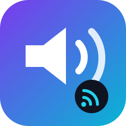

# CastVoice

**Desktop app to make your Google Nest / Google Cast speakers talk — type a message, pick a voice (even your own), or play any audio file on one or many speakers at once.**

*App desktop per far parlare i tuoi Google Nest / Google Cast: scrivi un messaggio, scegli una voce (anche la tua) oppure riproduci qualsiasi file audio su uno o più altoparlanti insieme.*



## Funzioni · Features

- 🔎 **Trova da sola** i Google Nest, Chromecast e gruppi sulla rete locale · finds speakers on your LAN
- 🔈 **Volume** per ogni dispositivo, selezione multipla · per-device volume, multi-select
- 💬 **Parla**: scrivi un testo e scegli la voce · type text, pick a voice
  - voci locali (`espeak-ng`), senza internet · offline voices
  - voci neurali online (Microsoft Edge TTS: italiano, inglese, spagnolo, francese, tedesco, portoghese) · online neural voices
  - **la tua voce clonata** (XTTS v2, sulla tua GPU) · **your own cloned voice**
  - velocità regolabile e **frasi rapide** salvate · speed control and saved quick phrases
- 🎵 **Audio**: trascina i tuoi file (mp3, wav, ogg, flac, m4a…) e riproducili sui Google · drag & drop your files
- 🎬 **Video → solo audio**: aggiungi un video (mp4, mkv, webm, mov, avi…) e sui Google si sente solo la sua traccia audio · add a video and only its soundtrack is played
- 🎙 **Registra clip** con il microfono e riproducile quando vuoi · record voice clips and play them anytime

## Privacy

La tua voce **non lascia mai il tuo computer**: registrazioni, campioni e profili vivono in
`~/.local/share/castvoice/`, fuori dal progetto, e `.gitignore` esclude ogni file audio.
La clonazione vocale gira in locale. Solo le voci «online» mandano il *testo* (mai la tua voce) al servizio di sintesi Microsoft Edge.

Your voice never leaves your computer: recordings and samples live in `~/.local/share/castvoice/`
(outside the repo). Only the *text* is sent to Microsoft when you choose an "online" voice.

## Installazione · Install

Requisiti · Requirements: Linux, Python ≥ 3.10, `ffmpeg`, `espeak-ng`, PipeWire (`pw-record`) per registrare · to record. Per clonare la voce: [`uv`](https://docs.astral.sh/uv/) e una GPU NVIDIA consigliata · for voice cloning.

```bash
git clone https://github.com/ALEXLIONBIT/castvoice.git
cd castvoice
./install.sh              # ambiente + icona + voce nel menu
./install.sh --pin-kde    # in più: icona fissata sulla barra di KDE Plasma
```

Poi apri **CastVoice** dal menu delle applicazioni, oppure `./run.sh`.

## Come si usa · Usage

1. Premi **⟳ Cerca** e spunta i dispositivi a sinistra · tick the speakers.
2. Scheda **Parla**: scrivi, scegli la voce, **▶ Parla** (`Ctrl+Invio`).
3. Scheda **Audio**: trascina i file, doppio clic per riprodurre.
4. Scheda **La mia voce**: installa il motore di clonazione una volta, accetta la licenza del modello, registra ~20 secondi di voce e scegli «La mia voce» tra le voci.

## Come funziona · How it works

I Google Cast non ricevono l'audio direttamente: gli si dà un URL e lo scaricano loro. CastVoice avvia un mini server HTTP locale (legato alla sola interfaccia di rete che raggiunge il dispositivo, nomi file casuali) e dice al dispositivo di riprodurre quell'URL tramite il protocollo Cast ([`pychromecast`](https://github.com/home-assistant-libs/pychromecast)). Il PC e i Google devono stare sulla stessa rete.

## Licenze · Licenses

Il codice è MIT. Il modello **XTTS v2** (clonazione) usa la *Coqui Public Model License*, **solo uso non commerciale**: viene scaricato solo dopo che accetti la licenza nell'app. Le voci Edge TTS sono un servizio Microsoft soggetto ai loro termini.

Code is MIT. The XTTS v2 model is non-commercial (CPML) and is only downloaded after you accept its licence in the app.
